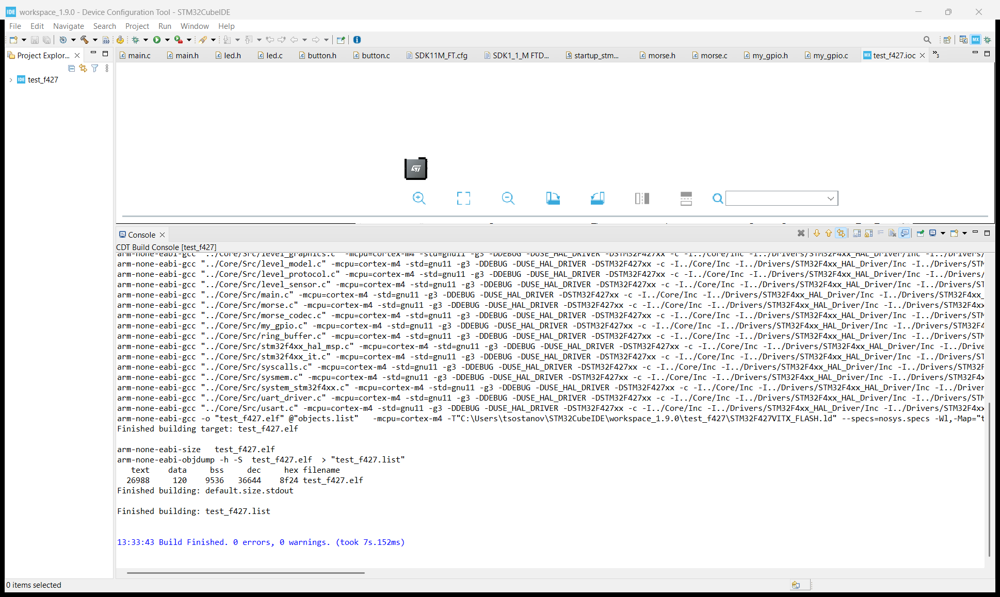
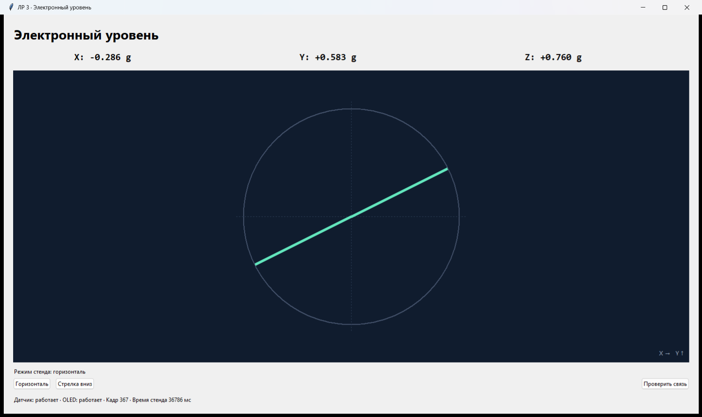
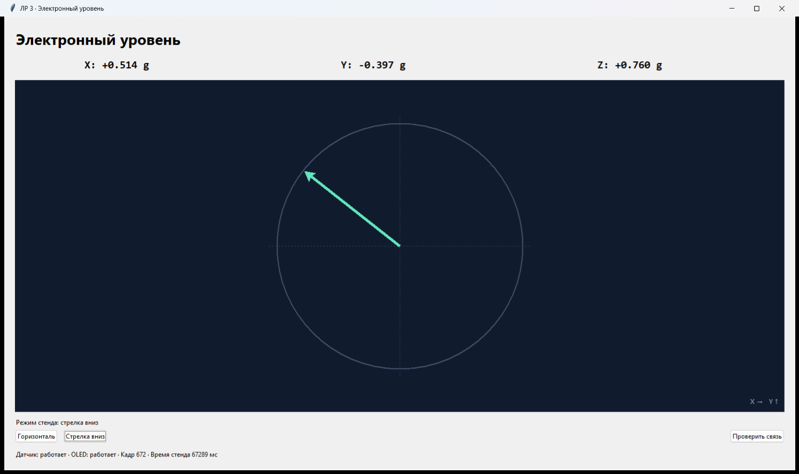
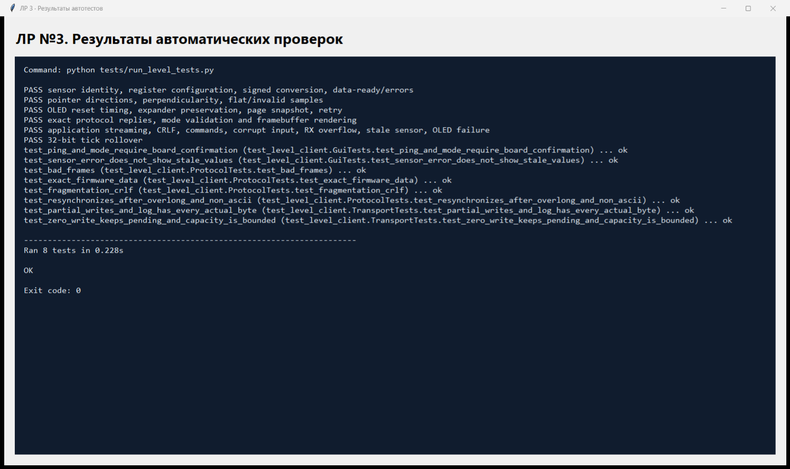

# Скриншоты для отчёта по ЛР №3

Изображения можно скачать и вставить в раздел с результатами работы.

## Сборка

Рисунок 1. Результат сборки проекта ЛР №3 в STM32CubeIDE.

## Интерфейс

Рисунок 2. Окно клиента в режиме HORIZ.

Рисунок 3. Окно клиента в режиме ARROW.

## Тесты

Рисунок 4. Результаты автоматических проверок ЛР №3.

[Текстовый журнал тестов](images/lab3/tests-output.txt)
